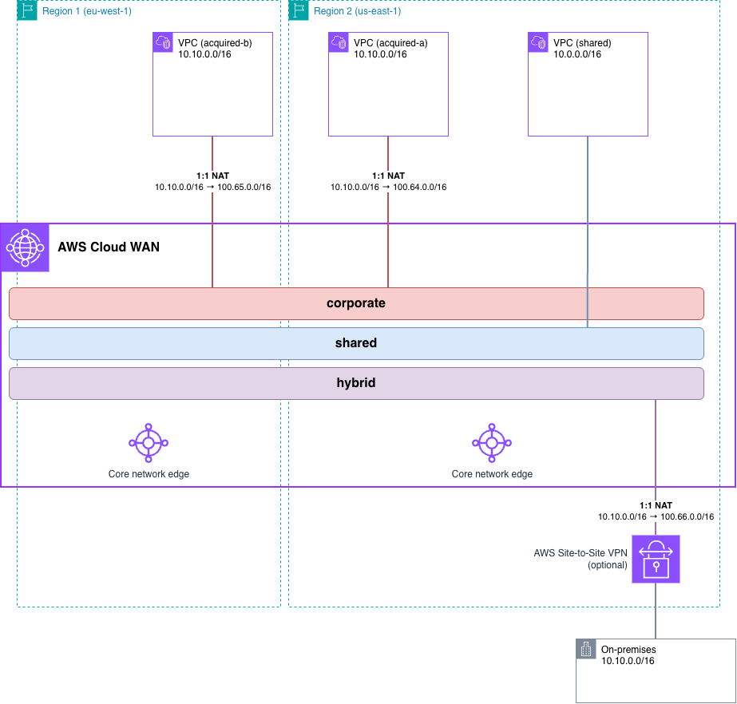

# Infrastructure-as-Code Patterns — 1:1 NAT on AWS Cloud WAN attachments (AWS CloudFormation)

In this pattern, we want to show how 1:1 NAT on Cloud WAN attachments connects networks whose CIDRs overlap.



See [the pattern README](../README.md) for what this builds, the NAT rules and tags it applies, what its baseline policy configures, and how to verify it.

## Prerequisites

- An AWS account with permissions for CloudFormation, Network Manager (including `networkmanager:UpdateAttachmentNatConfiguration`), EC2 (VPCs, subnets, instances, endpoints, customer gateways, VPN connections), and IAM.
- The AWS CLI, configured with credentials.
- `make`, which drives the stack ordering.

## Templates

| Template | Deploys | Region |
|----------|---------|--------|
| `core_network.yaml` | Global network, core network and the policy, plus the core network's Cloud WAN Flow Logs in a custom format that adds the NAT addresses with their CloudWatch Logs log group and delivery role | `us-west-2`, Cloud WAN's home Region |
| `workloads.yaml` | The VPCs of one Region, each with its Cloud WAN attachment, EC2 instances and EC2 Instance Connect endpoint: the acquired VPC with a NAT attachment (`AcquiredCWANAttachment`), plus the `shared` VPC with a plain one (`SharedCWANAttachment`) where `SharedVpcCIDR` has an entry for the Region | Once per Region: `shared` and `acquired-a` in `us-east-1`, `acquired-b` in `eu-west-1` |
| `vpn.yaml` | Customer gateway, BGP VPN connection, and its Cloud WAN attachment with NAT | `us-east-1` |

## Deploy

```bash
cd infra/7-attachment_nat/cloudformation
make deploy
```

That deploys the pattern with its working baseline policy: the core network and its flow logs first, then the workloads in both Regions. Between the two it polls every 30 seconds until the core network is `AVAILABLE` again, typically several minutes; [Flow Logs](../../README.md#flow-logs) explains why. To take it a stack at a time, `make deploy-cloudwan`, `make wait-cloudwan`, then `make deploy-workloads`. The VPC CIDRs and NAT CIDRs are in the `SharedVpcCIDR` and `AcquiredVpcCIDR` mappings of `workloads.yaml`, keyed by Region.

The VPN is a separate stack and is off by default, because it needs values only you can supply. The customer gateway ASN must not overlap the core network's `asn-ranges`, which the baseline sets to `64520-64525`:

```bash
make deploy-vpn CUSTOMER_GATEWAY_IP=203.0.113.10 CUSTOMER_GATEWAY_ASN=65010
```

`ONPREM_CIDR` (default `10.10.0.0/16`) and `ONPREM_NAT` (default `100.66.0.0/16`) set its NAT rule. The VPN tunnels stay down until a real on-premises device answers at `CUSTOMER_GATEWAY_IP`; see [Hybrid attachments](../README.md#hybrid-attachments) for what you can check without one.

> **Using a policy of your own?** CloudFormation needs the policy **inline** in the template — `PolicyDocument` takes JSON with no file or S3 option, and a stack parameter caps at 4,096 bytes — so instead of pointing at a different file you deploy a different template. `core_network.yaml` has to keep matching [`../baseline.json`](../baseline.json), which CI compares, so copy it rather than editing it.

## Cleanup

```bash
cd infra/7-attachment_nat/cloudformation
make undeploy
```

That removes the VPN stack and the workload stacks first, then the core network and its flow logs. The order matters: deleting a core network that still has attachments fails, and the error does not name the cause. To do it a stack at a time, `make undeploy-vpn`, `make undeploy-workloads`, then `make undeploy-cloudwan`.
